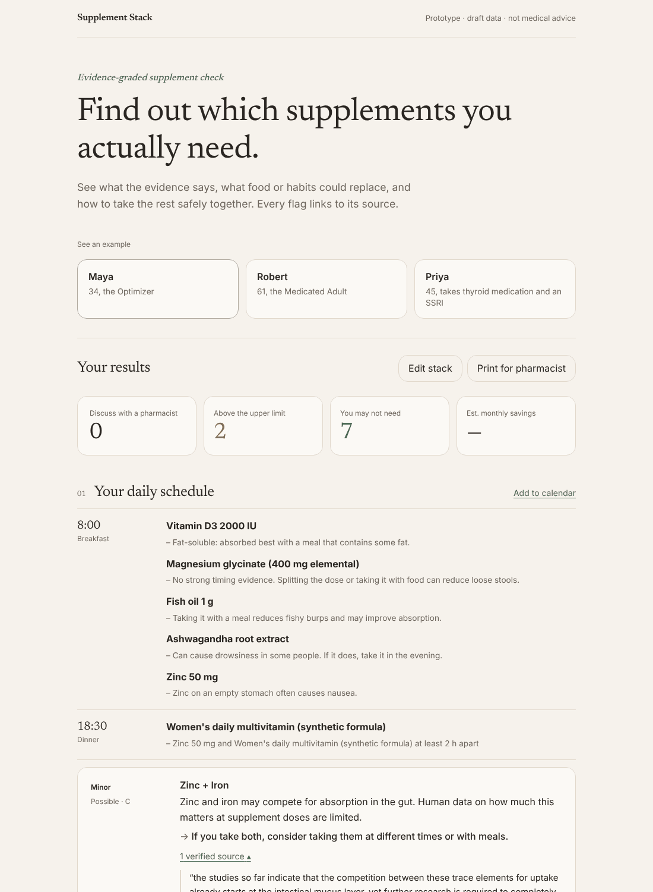

# Supplement Stack

**Find out which supplements you actually need. See what the evidence says, what food or habits could replace, and how to take the rest safely together.**

> 🧪 **[Try the prototype →](https://melaniebinder.github.io/Supplement-Stack-App/)** (draft data, not medical advice). Click an example stack to see results instantly.



> ⚠️ **Not medical advice.** This project is a product concept and prototype for educational purposes. It does not diagnose, treat, cure, or prevent any disease. Always talk to a doctor or pharmacist before you start, stop, or combine supplements or medications.

---

## 1. The problem

Most adults in the US take at least one dietary supplement, and many take several. People build these "stacks" from podcasts, social media, friends, and store shelves. Hardly anyone checks them as a whole.

- **Interactions are hard to see.** Supplement–supplement and supplement–medication interactions are spread across scientific papers and paid clinical databases. Consumer drug-interaction checkers mostly cover drugs and handle supplements poorly.
- **Evidence quality isn't visible.** A vitamin D claim backed by large randomized trials looks the same on a label as one backed by a single mouse study.
- **The default answer is "add another pill."** Most supplement products make money by selling supplements, so the advice is rarely "fix your sleep, eat more legumes, and you may not need this."

More detail is in [`docs/problem.md`](docs/problem.md).

## 2. Approach: key product bets

| Bet | What it means in the product |
|---|---|
| **"Do you actually need this?" is the headline** | Competitors already check stacks and schedule doses ([competitor scan](docs/research/competitor-scan.md)). We lead with which supplements food or habits could replace, plus estimated savings, and use the stack check, daily schedule, and label scan as the entry point (D-018). |
| **Lifestyle first, supplement second** | Every recommendation walks a ladder: diet → sleep, activity, sun → supplement. A supplement is suggested only when the lifestyle steps can't plausibly close the gap or the evidence supports it on its own. |
| **Every claim shows its evidence** | Each interaction and recommendation carries an evidence grade (A–D) and links to its sources. If there's no citation, the claim doesn't ship. |
| **A curated knowledge base, not a generative one** | Facts come from a structured, reviewed dataset. An LLM may be used later to *explain* facts it retrieved, never to *produce* them. |
| **No selling supplements** | No affiliate links and no private label. The product is worth something only if users trust it to be unbiased. |

### What we're deliberately *not* building (for now)
- Diagnosis, symptom checkers, or treatment advice for medical conditions
- Personalized dosing for pregnancy, breastfeeding, children, or people on complex medication regimens (they're sent to a clinician instead)
- Lab-result or wearable integrations
- A marketplace, affiliate links, or brand rankings
- A social or community feed

The reasoning behind each choice is in [`docs/decisions.md`](docs/decisions.md).

## 3. Status

**Stage: 💡 Product spec + draft knowledge base.** The app isn't built yet. A 30-ingredient evidence knowledge base is drafted in [`data/`](data/), with a validator that enforces the evidence rules in CI.

| Area | Status |
|---|---|
| Problem definition | ✅ Draft |
| PRD and user stories | ✅ Draft |
| Evidence model | ✅ Draft |
| Competitor scan | ✅ Desk research done; hands-on test pending |
| User interviews | ⏳ Guide written, interviews not started |
| Knowledge base (30 ingredients, 33 interactions) | 🟡 Evidence-verified (99/99 claims, interactions, habits and groups backed by stored quotes); needs expert review |
| Clickable prototype | 🟡 Live on GitHub Pages: stack check, daily schedule, swaps, evidence quotes, calendar export |
| Demo | [melaniebinder.github.io/Supplement-Stack-App](https://melaniebinder.github.io/Supplement-Stack-App/) |

## 4. Metrics: how we'd know it's working

- **North star:** the share of checked stacks that end up *safer or simpler*. That means a flagged interaction was acted on, a redundant supplement was removed, or a lifestyle change was chosen over a new supplement.
- **Activation:** the share of visitors who enter a stack of 2 or more items and see results.
- **Lifestyle-first adherence:** the share of recommendation sessions where a lifestyle or diet step is shown before any supplement. The target is 100%, and this is a product invariant.
- **Trust:** the share of users who open at least one evidence citation, plus a self-reported "I'd show this to my doctor" rating.
- **Guardrails:** zero claims without a citation, a tracked rate of user-reported content errors, and the time it takes to fix a reported error.

Full definitions are in [`docs/prd.md`](docs/prd.md#success-metrics).

## 5. Tech stack and how to run it

The prototype is a static Vite + React + TypeScript app on GitHub Pages (D-027), with the curated knowledge base as versioned YAML in the repo (D-007). See [`src/README.md`](src/README.md).

To validate the knowledge base (Node 18+):

```bash
npm install
npm run validate   # knowledge-base rules and evidence coverage
npm test           # engine tests against the synthetic stacks
npm run dev        # run the app locally
```

## Repo map

```
├── README.md
├── docs/
│   ├── problem.md          who it's for, the pain, evidence
│   ├── prd.md              scope, user stories, success metrics
│   ├── evidence-model.md   how claims are graded and sourced
│   ├── decisions.md        decision log
│   ├── roadmap.md          now / next / later
│   ├── manual-tasks.md     things that need a person (reviewer, API key, interviews)
│   └── research/
│       ├── competitor-scan.md
│       └── interview-guide.md
├── data/                   knowledge base (YAML) + synthetic test stacks
├── scripts/                validate-data.mjs
├── design/
│   └── wireframes.md
└── src/                    (added once building starts)
```

## Data and privacy notes

- All example data in this repo is **synthetic**. Example users and stacks are made up.
- Scientific sources are public (PubMed, NIH Office of Dietary Supplements, and similar). Licensed clinical databases are **not** copied into this repo.

## License

[MIT](LICENSE)
